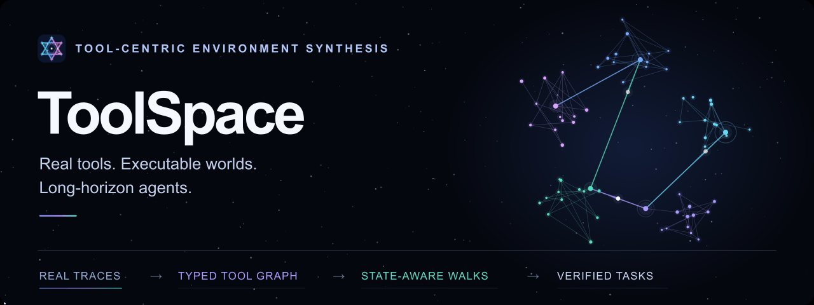
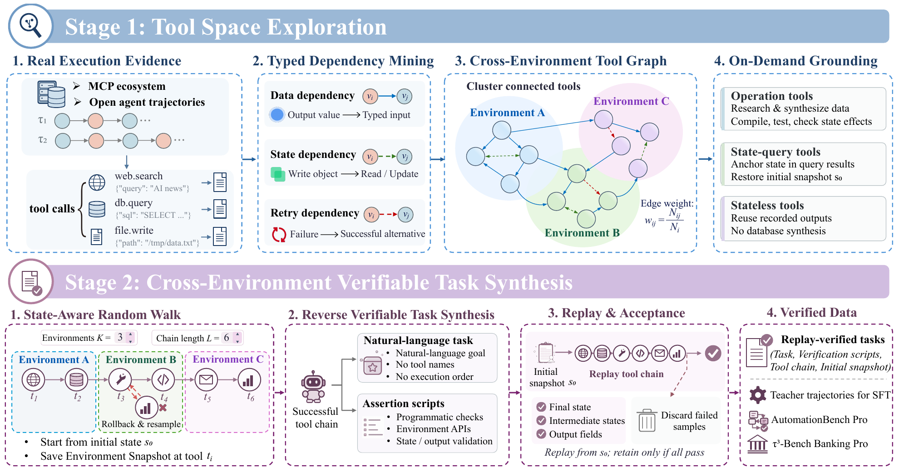
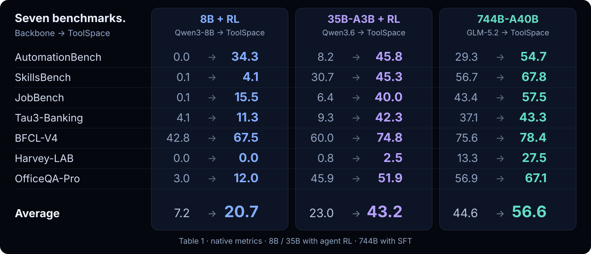

<div align="center">

<picture>
  <source media="(prefers-reduced-motion: reduce)" srcset="assets/readme/hero.svg">
  
</picture>

<h1>
  <picture>
    <source media="(prefers-color-scheme: dark)" srcset="assets/readme/title-dark.svg">
    
  </picture><br>
  Scaling Tool-Centric Environment Synthesis<br>for Long-Horizon Agents
</h1>

##### If you like our project, please give us a star ⭐ on GitHub for the latest update.

[](https://toolspace-agent.github.io/main.pdf)
[](https://huggingface.co/dongguanting/ToolSpace-8B)
[](https://huggingface.co/dongguanting/ToolSpace-35B-A3B)
[](https://huggingface.co/dongguanting/ToolSpace-744B-A40B)

<!-- TODO: Link the arXiv badge when released. -->

*From real tool traces to executable environments and long-horizon tasks through **typed dependencies, state-aware walks, and replay verification**.*

[Demo](#demo) · [Method](#method) · [Results](#results) · [Repository](#repository) · [Quick Start](#quick-start) · [Citation](#citation)

</div>

<table align="center">
<tr>
<td align="center" width="25%"><b>2,042</b><br><sub>canonical tools</sub></td>
<td align="center" width="25%"><b>804</b><br><sub>environments</sub></td>
<td align="center" width="25%"><b>34,376</b><br><sub>SFT samples</sub></td>
<td align="center" width="25%"><b>7</b><br><sub>evaluation benchmarks</sub></td>
</tr>
</table>

<a id="demo"></a>
## 🎬 ToolSpace in One Minute

https://github.com/user-attachments/assets/05d377d9-8247-4a8a-92b0-70aa658579af

<p align="center">
  <a href="https://github.com/user-attachments/assets/05d377d9-8247-4a8a-92b0-70aa658579af"><b>▶ Watch / download the 1080p video</b></a> &nbsp;·&nbsp;
  <a href="https://toolspace-agent.github.io/#demo"><b>Explore the interactive demo ↗</b></a><br>
  <sub>Illustrative graph simulation · executable replay available in the offline demo.</sub>
</p>

<a id="method"></a>
## 🛰️ From Tool Traces to Verified Tasks

<p align="center"><br><sub>Framework overview · Figure 2 in the paper.</sub></p>

### 1 · Explore and ground the tool space

Mine adjacent calls in real MCP and open-agent traces with **deterministic rules**. Nodes encode tools and normalized arguments; edges capture observed dependencies. Cluster the graph into environments, synthesizing persistent data for operation tools, restoring state for query tools, and reusing recorded outputs for stateless tools.

| Dependency | Execution evidence | Share of edges |
| :--- | :--- | ---: |
| 🟣 **Data** | An output value supplies a type-compatible input to the next call. | 69% |
| 🟢 **State** | One call changes an object that a later call reads or updates. | 25% |
| 🟠 **Retry** | A failed call is followed by a successful alternative. | 6% |

### 2 · Walk, reverse-synthesize, and replay

Sample **state-compatible successors** by edge weight, grounding arguments in the task, initial state, or earlier observations. Checkpoint before execution; **roll back and resample** on failure. Reverse-synthesize the successful workflow into a goal and state/trace/output assertions, then **replay from the initial snapshot** before acceptance.

<table>
<tr>
<td width="50%"><b>Cross-environment composition</b><br>66.2% of the analyzed trajectories span at least two environments; the mean is 18.86 tool calls.</td>
<td width="50%"><b>Ground only what needs state</b><br>55.3% fewer synthesized files in a 500-environment study: 2,724 → 1,218.</td>
</tr>
</table>

<sub>Trajectory statistics use the 21,385 trajectories with at least five calls. File count is the paper's synthesis-cost proxy, not a measured reduction in dollars or runtime. See §5 and §6.4.</sub>

<a id="results"></a>
## 📊 Main Results

**Backbone → ToolSpace** on all seven benchmarks. Scores use each benchmark's native metric.

<p align="center"></p>

<details>
<summary><b>Per-benchmark scores · Table 1</b></summary>

| Model | AutomationBench | SkillsBench | JobBench | Tau3-Banking | BFCL-V4 | Harvey-LAB | OfficeQA-Pro | Avg. |
| :--- | ---: | ---: | ---: | ---: | ---: | ---: | ---: | ---: |
| Qwen3-8B | 0.0 | 0.1 | 0.1 | 4.1 | 42.8 | 0.0 | 3.0 | 7.2 |
| ToolSpace-8B | 32.3 | 3.9 | 13.1 | 10.3 | 65.3 | 0.0 | 12.0 | 19.6 |
| ToolSpace-8B + RL | 34.3 | 4.1 | 15.5 | 11.3 | 67.5 | 0.0 | 12.0 | **20.7** |
| Qwen3.6-35B-A3B | 8.2 | 30.7 | 6.4 | 9.3 | 60.0 | 0.8 | 45.9 | 23.0 |
| ToolSpace-35B-A3B | 45.8 | 42.4 | 40.0 | 34.0 | 74.3 | 1.7 | 48.9 | 41.0 |
| ToolSpace-35B-A3B + RL | 45.8 | 45.3 | 40.0 | 42.3 | 74.8 | 2.5 | 51.9 | **43.2** |
| GLM 5.2 | 29.3 | 56.7 | 43.4 | 37.1 | 75.6 | 13.3 | 56.9 | 44.6 |
| ToolSpace-744B-A40B | 54.7 | 67.8 | 57.5 | 43.3 | 78.4 | 27.5 | 67.1 | **56.6** |
| Claude Opus 5 | 45.6 | 63.7 | 68.0 | 48.7 | 80.6 | 22.7 | 67.2 | **56.6** |

</details>

### Harder tasks with the Pro benchmarks

Six frontier models lose **up to 32.9 points** on ToolSpace-generated Pro tasks.

| Model | Automation → Pro | Banking → Pro |
| :--- | :---: | :---: |
| Claude Opus 5.5 | 59.2 → **26.3** (−32.9) | 51.5 → **35.7** (−15.8) |
| GPT 6.1 Sol | 50.8 → **24.7** (−26.1) | 46.4 → **29.6** (−16.8) |
| DeepSeek-V4.1-Flash | 50.0 → **20.0** (−30.0) | 47.4 → **35.7** (−11.7) |
| GLM 5.3 | 51.5 → **22.7** (−28.8) | 40.2 → **20.4** (−19.8) |
| Qwen 3.8 Max | 49.7 → **24.0** (−25.7) | 55.2 → **29.6** (−25.6) |
| GLM 5.2 | 29.3 → **18.0** (−11.3) | 37.1 → **12.2** (−24.9) |

<sub>Source: Table 2. Parentheses show Pro − standard in percentage points. The paper reports 600 Automation-Pro tasks; the current public [Automation-Pro](Automation-Pro/) package contains 300 frozen tasks. [Tau3-Banking-Pro](Tau3-Banking-Pro/) contains 98 tasks, separate from the original 97-task banking set.</sub>

<a id="repository"></a>
## 📂 Repository Guide

| Directory | Use |
| :--- | :--- |
| [Tool-Space](Tool-Space/README.md) | Generate tasks: simulator → tool graph → workflow → task/verifier → replay. |
| [benchmark](benchmark/README.md) | Run seven suites with pinned dependencies and unified outputs. |
| [Automation-Pro](Automation-Pro/README.md) | Evaluate 300 automation tasks across six domains. |
| [Tau3-Banking-Pro](Tau3-Banking-Pro/README.md) | Evaluate 98 banking tasks with 698 knowledge documents and native outcome scoring. |

```text
ToolSpace/
├── Tool-Space/                  # Task synthesis: graph → walk → task → replay
│   ├── automation_environment/  # Local simulator, tool catalog, and checkpoints
│   ├── tool_graph/              # Typed dependencies and executable workflow sampling
│   ├── task_generation/         # Model prompts, task/verifier generation, and export
│   ├── verification/            # Independent replay and native scoring
│   ├── examples/                # Input bundles, walk configs, and offline fixtures
│   └── run_pipeline.py          # Full pipeline and individual-stage CLI
├── benchmark/                   # Seven standard evaluation suites
│   ├── AutomationBench/
│   ├── SkillsBench/
│   ├── JobBench/
│   ├── Tau3-Banking/
│   ├── BFCL-V4/
│   ├── Harvey-LAB/
│   └── OfficeQA-Pro/
├── Automation-Pro/              # Frozen automation challenge set
├── Tau3-Banking-Pro/             # Frozen banking challenge set
└── assets/                      # README figures and edited demo video
```

**Release scope:** `Tool-Space/` implements Automation-based synthesis with **47 services and 758 endpoints**. The broader tool-space and training statistics above describe the paper's experiments.

<a id="quick-start"></a>
## 🚀 Quick Start

```bash
git clone https://github.com/dongguanting/ToolSpace.git
cd ToolSpace
```

Run each recipe below from the repository root, using its own dependencies.

### 1 · Generate and verify a task offline

Requires **Python 3.13+** and [uv](https://docs.astral.sh/uv/getting-started/installation/).

```bash
cd Tool-Space
uv sync --locked
uv run python run_pipeline.py demo --output outputs/demo
uv run python run_pipeline.py verify --tasks outputs/demo/tasks
```

**No API key needed.** Environment execution and replay are real; model responses use fixtures. Use a fresh output directory. The dataset, summary, and replay report are saved under `outputs/demo/tasks/`.

<details>
<summary><b>Generate new tasks with your model</b></summary>

From `Tool-Space/`, configure an OpenAI-compatible endpoint:

```bash
export PRO_MODEL="your-model"
export PRO_BASE_URL="https://api.example.com/v1"
export PRO_API_KEY="your-key"
export PRO_API="chat"  # Use "responses" for the Responses API.

uv run python run_pipeline.py run \
  --input examples/project_reconciliation.json \
  --walk-config examples/walk.json \
  --count 1 --seed 42 --output outputs/pro
```

`.env` is not loaded automatically. See the [input format](Tool-Space/docs/input-format.md) and [pipeline guide](Tool-Space/README.md) for custom inputs, individual stages, and resume support.

</details>

### 2 · Run the seven-benchmark evaluation harness

Requires **Linux**, `uv`, and Node.js 18+; Docker for SkillsBench, Podman for Harvey-LAB, and user namespaces for banking. See [setup and API access](benchmark/README.md#install).

```bash
cd benchmark
cp .env.example .env
# Edit .env: MODEL, MODEL_BASE_URL, MODEL_API_KEY, and required auxiliary keys.
bash setup_all.sh

# Start with one task, then run the full suite.
SCOPE=smoke RUN_NAME=my-model-smoke bash AutomationBench/run.sh
RUN_NAME=my-model bash run_all.sh
```

Run one suite with `bash <directory>/run.sh`. All launchers support `--limit N`, `--tasks ID,ID`, and `--check-only`. Outputs: `benchmark/outputs/<benchmark>/<RUN_NAME>/`.

<details>
<summary><b>Which tasks and metrics does each directory use?</b></summary>

| Directory | Evaluation set | Metric |
| :--- | :--- | :--- |
| [AutomationBench](benchmark/AutomationBench/) | 600 public tasks | Strict task pass rate |
| [SkillsBench](benchmark/SkillsBench/) | 79 tasks × 3 trials | Mean official verifier reward |
| [JobBench](benchmark/JobBench/) | 65 tasks | Mean rubric score |
| [Tau3-Banking](benchmark/Tau3-Banking/) | 97 Banking Knowledge tasks | Native task success rate |
| [BFCL-V4](benchmark/BFCL-V4/) | 5,217 `all_scoring` cases | Official weighted overall accuracy |
| [Harvey-LAB](benchmark/Harvey-LAB/) | Fixed 120-task sample | Official all-pass rate |
| [OfficeQA-Pro](benchmark/OfficeQA-Pro/) | 133 questions | Official answer accuracy |

OfficeQA-Pro needs [dataset access](https://huggingface.co/datasets/databricks/officeqa) and `HF_TOKEN`. Configure auxiliary model, retrieval, and search APIs in the [API guide](benchmark/README.md#model-apis-and-data).

</details>

### 3 · Validate and evaluate the Pro packages

<details>
<summary><b>Automation-Pro · 300 tasks · Python 3.10+</b></summary>

```bash
cd Automation-Pro
python -m pip install -r requirements.txt
python evaluate.py validate
```

Replay saved tool calls without a model API, or evaluate a model directly:

```bash
python evaluate.py replay --input predictions.jsonl --output results/replay

export OPENAI_API_KEY="your-key"
python evaluate.py run --model your-model \
  --base-url https://api.example.com/v1 \
  --api chat --api-key-env OPENAI_API_KEY \
  --output results/my-model --concurrency 4
```

Use a fresh result directory. See the [prediction format and scoring guide](Automation-Pro/README.md).

</details>

<details>
<summary><b>Tau3-Banking-Pro · 98 tasks · Linux / Python 3.12</b></summary>

```bash
cd Tau3-Banking-Pro
uv venv --python 3.12 .venv
uv pip install --python .venv/bin/python -r requirements.txt
.venv/bin/python evaluate.py --check-only
```

For a live run, export the variables in `.env.example` and install the [knowledge-shell dependencies](Tau3-Banking-Pro/README.md#setup-and-offline-validation):

```bash
.venv/bin/python evaluate.py \
  --limit 1 --concurrency 1 --output outputs/pro98-smoke \
  --reasoning-effort max --no-review
```

Use a supported reasoning effort; remove `--limit 1` for all 98 tasks. Report **Pro98** with the model and retrieval configuration. Scoring compares database outcomes, not exact call sequences.

</details>

Keep reference trajectories and verifier targets on the evaluator side.

<a id="citation"></a>
## 📄 Citation

```bibtex
@article{dong2026toolspace,
  title   = {ToolSpace: Scaling Tool-Centric Environment Synthesis for Long-Horizon Agents},
  author  = {Dong, Guanting and Sun, Zhichao and Yang, Xinyu and others},
  year    = {2026},
  url     = {https://toolspace-agent.github.io/}
}
```

## Acknowledgments

We thank the creators of [AutomationBench](https://github.com/zapier/AutomationBench), [SkillsBench](https://github.com/benchflow-ai/skillsbench), [JobBench](https://github.com/Job-Bench/job-bench-eval), [tau2-bench](https://github.com/sierra-research/tau2-bench), [BFCL](https://github.com/ShishirPatil/gorilla), [Harvey LAB](https://github.com/harveyai/harvey-labs), and [OfficeQA](https://github.com/databricks/officeqa). Third-party components retain their respective licenses and attribution; see the license and notice files in each module.

<p align="center"><a href="mailto:dongguanting@ruc.edu.cn">Contact</a></p>
