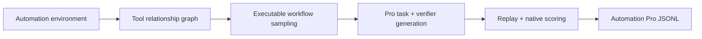

# Tool-Space: Automation → Automation Pro

Build an observed tool graph inside Automation environments, sample executable workflows, jointly generate Pro tasks and native verifiers, replay the references, and export Automation Pro datasets.



## Layout

```text
Tool-Space/
├── README.md
├── automation_environment/    # Simulator, endpoint catalog, checkpoints, bundled environment
├── tool_graph/                # Observed dependencies, argument grounding, workflow sampling
├── task_generation/           # Evidence, prompts, model client, joint task/verifier synthesis, export
├── verification/              # Reference replay and native assertion scoring
├── examples/                  # Synthetic workflow bundle, walk configs, offline model fixtures
├── run_pipeline.py            # Full pipeline and individual stage commands
├── tests/
├── docs/
├── pyproject.toml
└── uv.lock
```

The bundled Automation environment supports 47 services and 758 endpoints. Its API calls execute locally. Python **3.13+** and [uv](https://docs.astral.sh/uv/getting-started/installation/) are required. The bundled fixtures are synthetic and do not contain production records or credentials.

## Offline demo

```bash
uv sync --locked
uv run python run_pipeline.py demo --output outputs/demo
uv run python run_pipeline.py verify --tasks outputs/demo/tasks
```

The demo runs real environment execution, graph inference, new workflow sampling, native scoring, export and independent replay. Only model responses are fixed fixtures. No API key is needed. Use a new output directory for each full run.

## Full pipeline with a model

Configure an OpenAI-compatible Chat Completions or Responses model. Credentials come from `PRO_API_KEY`; `.env` is not loaded automatically. See [.env.example](.env.example).

```bash
export PRO_MODEL="your-model"
export PRO_BASE_URL="https://api.openai.com/v1"
export PRO_API_KEY="your-key"
export PRO_API="chat"

uv run python run_pipeline.py run \
  --input examples/project_reconciliation.json \
  --walk-config examples/walk.json \
  --count 1 --seed 42 --output outputs/pro
```

`run` builds the graph, samples workflows, calls the model, replays accepted tasks and exports the dataset. It exits with status 2 if the requested walk count cannot be reached, generation has runtime errors, or no task is accepted. Rejections and errors remain in the output for inspection.

For Responses use `PRO_API=responses`. Add `--reasoning-effort high` only if supported by the provider. Unauthenticated endpoints can use an empty key. Network failures and 429/5xx responses receive bounded retries. Keep `PRO_API_KEY` in the environment; it is not read from or written to repository files.

The included reconciliation bundle is a small integration example. For broader generation, supply valid initial states and successful workflows using the [input format](docs/input-format.md). `examples/pro_walk.json` illustrates constraints for a larger graph.

## Individual stages and resume

The `automation-pro` console command exposes the same commands as `run_pipeline.py`.

```bash
uv run automation-pro graph --input examples/project_reconciliation.json --output outputs/graph
uv run automation-pro walk --graph outputs/graph --config examples/walk.json \
  --count 1 --seed 42 --output outputs/walks
uv run automation-pro synthesize --graph outputs/graph --walks outputs/walks/walks.jsonl \
  --output outputs/tasks
uv run automation-pro verify --tasks outputs/tasks
```

Resume interrupted synthesis by repeating `synthesize` with `--resume`. Accepted/rejected tasks and completed model stages are cached. Resume checks input, code and model-setting fingerprints; credentials and timeouts may change. Use separate processes and output directories for parallel runs, since simulator clock and UUID state are process-local.

## Generation and verification

The extracted default `grounded_decisions_v2` prompts use trajectory observations and state differences to plan evidence-dependent tasks, including reconciliation across queried sources. Question and native assertion generation share one contract. A separate model call audits coverage, source accessibility, difficulty and answer leakage. Rejected plans remain rejected; the original bounded writer attempts are retained.

Reference replay checks observations and state hashes, then requires full native AutomationBench `partial_credit`. This establishes reference executability. Native existence/keyword assertions retain their original limitations, including cases where duplicates or incorrect relationships between message keywords can pass. No extra scoring guards are added.

## Outputs

```text
outputs/pro/
├── graph/                    # Catalog, observed relations, source tasks and checkpoints
├── walks/                    # Executable sampled workflows and search summary
└── tasks/
    ├── automation_pro.jsonl   # Self-contained Pro tasks, verifiers and reference trajectories
    ├── automationbench_dataset.jsonl
    ├── manifest.json
    ├── summary.json
    ├── independent_validation.json
    ├── rejected.jsonl
    ├── errors.jsonl
    ├── jobs/                 # Per-task generation evidence and replay results
    └── model_calls/           # Requests/responses without auth headers
```

`verify` needs only the exported Pro JSONL and the installed runtime. For RL, expose questions and tools to the agent while keeping references and verifier targets on the evaluator side. To score an agent's final WorldState:

```bash
uv run automation-pro score --task outputs/pro/tasks/jobs/<sample>/pro_task.json \
  --final-state agent_final_state.json
```

## Development and provenance

```bash
uv run ruff check .
uv run ruff format --check .
uv run pytest
uv build
```

CI runs tests, the complete offline pipeline, exported replay and a clean wheel installation. See [validation](docs/validation.md), [source mapping](docs/source-mapping.md), and [中文说明](docs/README.zh-CN.md).

AutomationBench is attributed to Zapier, Inc. Its complete MIT license and scope statement are preserved in [automation_environment/vendor/AUTOMATIONBENCH_LICENSE](automation_environment/vendor/AUTOMATIONBENCH_LICENSE). [NOTICE](NOTICE) records local adaptations. Before redistributing modified copies, review the notices and the project license selected for the synthesis code.
